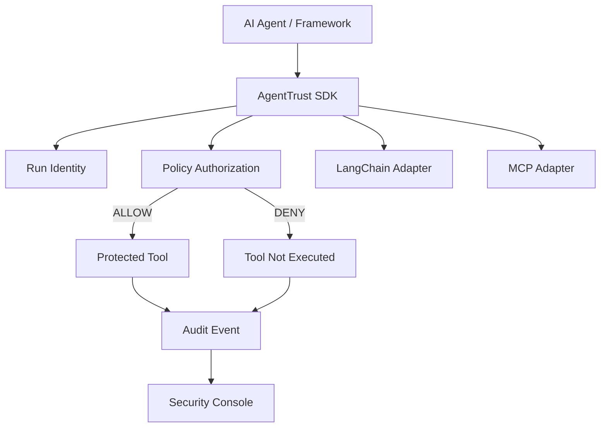
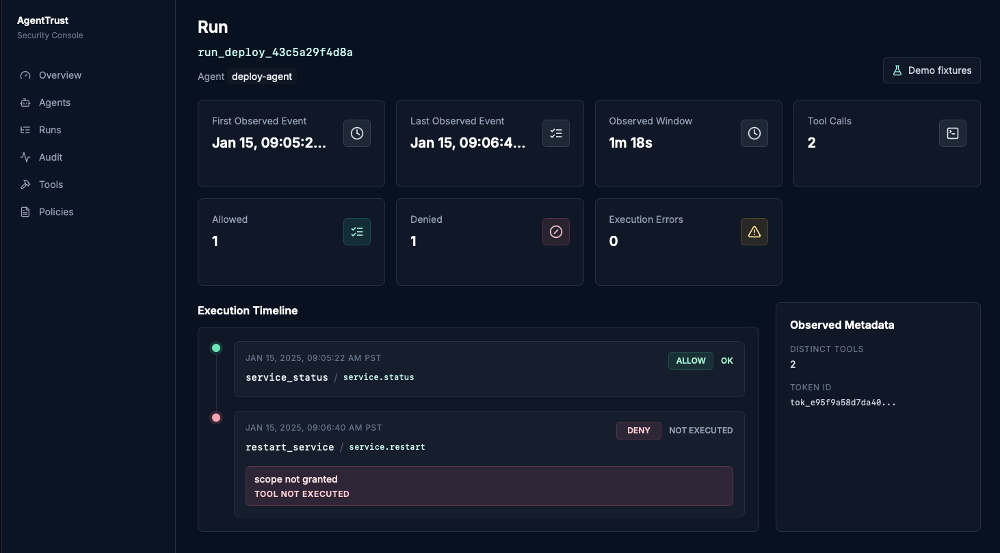
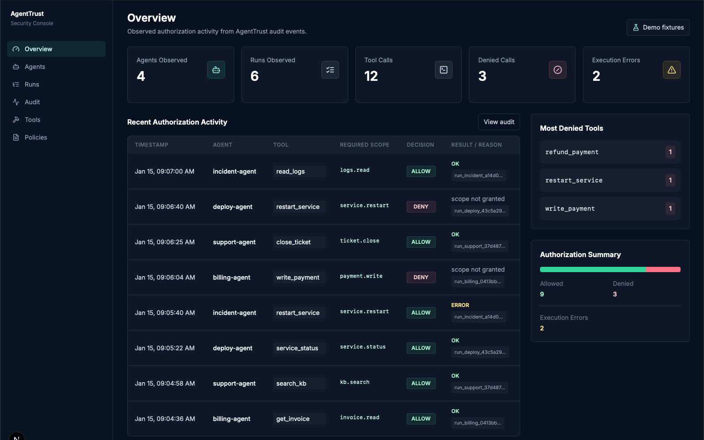
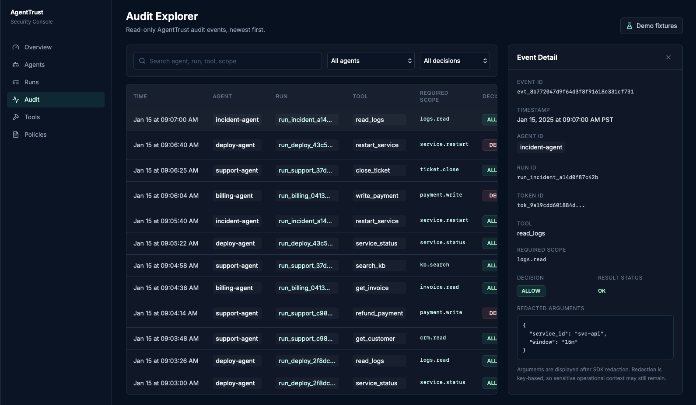

# AgentTrust

[](https://github.com/ravionxgroup/agenttrust/actions/workflows/ci.yml)

Least-privilege identity, scoped authorization, and audit visibility for AI agent tool calls.

AgentTrust combines a Python SDK, a separately maintained Go enforcement Gateway,
and a read-only Next.js Console. Gateway mode routes HTTP/MCP tool requests through
signature validation, exact-scope authorization, bounded execution and persisted
audit lifecycle events. Existing local SDK guards remain available.

> **Two explicit modes.** Local SDK guards are cooperative and can be bypassed by
> code holding a direct tool client. Gateway mode uses externally issued Ed25519
> credentials and an independent enforcement boundary. Preventing other network
> paths requires the verified local Docker topology; this is not a universal
> isolation or production-readiness claim.

Read the [MVP overview and limitations](docs/mvp-overview.md) and
[Gateway SDK guide](docs/gateway-sdk.md). The full local stack requires authorized
access to the separate Gateway repository.

## Why AgentTrust

Agent frameworks make it easy to give autonomous workflows broad, long-lived tool access. AgentTrust narrows that surface:

- short-lived per-run agent identity instead of broad ambient authority
- scoped authorization for each protected tool call
- deny-by-default policy behavior for unknown agents and missing scopes
- authorization before tool execution
- audit events for allowed calls, denied calls, and execution errors
- MCP and LangChain integrations without coupling them to the core SDK
- a read-only Security Console for local visibility

## How It Works

Gateway mode:

```text
AI Agent -> Python SDK -> TLS Go Gateway -> Protected HTTP/MCP Tool
                              |
                       Persisted audit -> Read-only Console
```

Local SDK mode (the standalone examples below):

```text
AI Agent / Framework
  -> AgentTrust SDK
  -> Run Identity
  -> Policy Authorization
  -> Protected Tool
  -> Audit Event
  -> Security Console
```

Security behavior:

```text
Agent requests tool
  -> required scope evaluated
  -> ALLOW
  -> execute tool
  -> audit result
```

```text
Agent requests tool
  -> required scope evaluated
  -> DENY
  -> tool is NOT executed
  -> audit denial
```

## Core Capabilities

- **Per-run identity:** local `start_run()` issues HS256 identities; Gateway mode accepts externally issued Ed25519 JWTs without an SDK signing key.
- **Gateway execution:** explicit sync/async clients and LangChain/MCP adapters route protected calls through the Gateway without retry or local fallback.
- **Scoped authorization:** each guarded call declares the required scope for that tool operation.
- **Deny by default:** unknown agents and out-of-scope calls fail closed.
- **Authorize before execution:** denied calls do not invoke the wrapped tool.
- **Audit trail:** each call attempt writes an audit event with decision, reason, redacted arguments, and execution result when applicable.
- **MCP integration:** MCP client/session wrappers authorize MCP tool calls with explicit or metadata-provided scopes.
- **LangChain integration:** helpers expose guarded callables as LangChain tools.
- **Security Console:** projects persisted Gateway events by invocation ID, keeping authorization, execution and incomplete/conflicting evidence separate; legacy SDK/fixture views are explicit modes.

## Architecture

This diagram describes local SDK mode. Gateway mode and its independent trust
boundary are described in the [MVP overview](docs/mvp-overview.md).



Core modules:

- `agenttrust/identity.py`: token issuance and verification
- `agenttrust/policy.py`: declarative deny-by-default scope policy
- `agenttrust/audit.py`: JSONL audit events and argument redaction
- `agenttrust/langchain.py`: LangChain adapter
- `agenttrust/mcp.py`: MCP client/session adapter
- `console/`: read-only Security Console

## Security Console

The AgentTrust Security Console is a local, read-only Next.js application in [console/](console/). It provides visibility into:

- Overview
- Agents
- Runs
- Audit Explorer
- Tools
- Declared Policies

The Console separates data sources deliberately:

- **Gateway mode (default):** invocations and timelines are projected from explicitly configured persisted Gateway JSONL; unavailable sources show an error.
- **Legacy SDK mode:** SDK events and optional policy data use a separate schema.
- **Fixture mode:** explicitly selected demo data; never a fallback after real ingestion fails.

The Console never executes tools, edits audit records, grants permissions or
issues credentials. Enforcement stays in the selected local SDK or Gateway mode.

### Screenshots



Run Detail demonstrates a `restart_service` request denied because `service.restart` was not granted. The protected tool was not executed.



Overview shows read-only authorization and audit visibility derived from AgentTrust audit events.

## Quick Start

### Python SDK

Install from source:

```bash
git clone https://github.com/ravionxgroup/agenttrust.git
cd agenttrust
python3 -m pip install --upgrade pip
python3 -m pip install -e .
```

Install development dependencies:

```bash
python3 -m pip install -e ".[dev]"
```

Optional extras:

```bash
python3 -m pip install -e ".[yaml]"
python3 -m pip install -e ".[langchain]"
python3 -m pip install -e ".[mcp]"
python3 -m pip install -e ".[all]"
```

Run tests:

```bash
python3 -m pytest
```

Run examples:

```bash
python3 examples/demo.py
python3 examples/mcp_demo.py
python3 examples/mcp_authorization_evidence.py
python3 examples/langchain_demo.py
```

### Basic SDK Usage

```python
from agenttrust import AgentTrust, ToolDenied
from agenttrust.policy import Policy

at = AgentTrust(
    policy=Policy.from_yaml("policy.example.yaml"),
    secret="your-32-char-secret-key-here!!!",
)

with at.start_run("support-agent") as run:
    result = run.call("crm.read", get_customer, customer_id=42)

    try:
        run.call("payment.refund", do_refund, amount=500)
    except ToolDenied:
        pass
```

### Security Console

Install and run the Console:

```bash
cd console
npm ci
AGENTTRUST_CONSOLE_SOURCE=gateway AGENTTRUST_GATEWAY_AUDIT_PATH=/absolute/physical/path/gateway-audit.jsonl npm run dev -- --hostname 127.0.0.1
```

The default source is Gateway audit. Missing configuration or files produce an
explicit unavailable state. To select demo fixtures:

```bash
AGENTTRUST_CONSOLE_SOURCE=fixtures npm run dev -- --hostname 127.0.0.1
```

Use the legacy local SDK audit format explicitly:

```bash
AGENTTRUST_CONSOLE_SOURCE=sdk AGENTTRUST_AUDIT_PATH=../agenttrust_audit.jsonl npm run dev -- --hostname 127.0.0.1
```

Optional policy display is for legacy SDK mode:

```bash
AGENTTRUST_CONSOLE_SOURCE=sdk AGENTTRUST_POLICY_PATH=../policy.example.yaml npm run dev -- --hostname 127.0.0.1
```

Use both in legacy SDK mode (set the mode explicitly in this shell):

```bash
export AGENTTRUST_CONSOLE_SOURCE=sdk
```

```bash
AGENTTRUST_AUDIT_PATH=../agenttrust_audit.jsonl \
AGENTTRUST_POLICY_PATH=../policy.example.yaml \
npm run dev -- --hostname 127.0.0.1
```

Build the Console:

```bash
npm run build
```

## Audit Events

In local SDK mode, each guarded call attempt writes one JSON line to
`agenttrust_audit.jsonl` by default. Gateway mode instead persists multiple
lifecycle events per invocation; the Console counts invocation IDs, not rows.



Audit Explorer supports event-level inspection of authorization decisions, execution outcomes, redacted arguments, and denial reasons.

```json
{"event_id":"evt_...","ts":1234567890.1,"agent_id":"support-agent","run_id":"run_abc","token_id":"tok_xyz","tool":"get_customer","required_scope":"crm.read","decision":"allow","reason":null,"args_redacted":{"customer_id":42},"result_status":"ok"}
{"event_id":"evt_...","ts":1234567890.2,"agent_id":"support-agent","run_id":"run_abc","token_id":"tok_xyz","tool":"do_refund","required_scope":"payment.refund","decision":"deny","reason":"scope not granted","args_redacted":{"amount":500},"result_status":null}
```

Sensitive argument keys such as `password`, `token`, `api_key`, `access_token`, and `client_secret` are redacted before logging. Redaction is key-based and may not remove all sensitive operational context.

View the audit log:

```bash
agenttrust audit
agenttrust audit --last 20
agenttrust audit --decision deny
agenttrust audit --agent support-agent
agenttrust audit --raw
```

## Integrations

LangChain:

```python
from agenttrust.langchain import as_langchain_tools

with at.start_run("support-agent") as run:
    tools = as_langchain_tools(run, [
        ("crm.read", get_customer),
        ("ticket.create", create_ticket),
    ])
```

MCP:

```python
from agenttrust.mcp import wrap_mcp_client

with at.start_run("support-agent") as run:
    mcp = wrap_mcp_client(
        run,
        session,
        tool_scopes={"get_customer": "crm.read"},
    )
    result = await mcp.call_tool("get_customer", {"customer_id": 42})
```

MCP tools can also declare required scopes in metadata:

```python
@server.tool(meta={"agenttrust/scope": "crm.read"})
def get_customer(customer_id: int) -> dict:
    ...
```

## Boundaries And Limitations

- Local SDK guards are in-process; Gateway mode uses independent authorization plus deployment isolation.
- The Console is read-only and has no authentication or RBAC.
- Local JSONL audit is append-only-style by convention, not immutable or tamper-proof storage.
- There is no managed control plane, centralized policy service, distributed enforcement system, production SaaS, or security findings/risk engine.
- Local tokens use HS256. Gateway mode accepts externally issued Ed25519 JWTs; managed issuance, rotation, JWKS and revocation are not implemented.
- Run timing in the Console uses first and last observed audit events, not explicit run lifecycle records.

## Repository Navigation

| Path | Purpose |
|---|---|
| [agenttrust/](agenttrust/) | Python SDK package |
| [examples/](examples/) | Runnable SDK, MCP, and LangChain examples |
| [tests/](tests/) | Unit and adapter tests |
| [console/](console/) | Read-only AgentTrust Security Console |
| [policy.example.yaml](policy.example.yaml) | Example deny-by-default policy |
| [docs/onboarding.md](docs/onboarding.md) | Evaluation and integration walkthrough |
| [docs/threat-model.md](docs/threat-model.md) | Trust boundary and threat model |
| [docs/evidence/README.md](docs/evidence/README.md) | Verified runtime evidence index |
| [docs/feedback.md](docs/feedback.md) | Structured evaluator feedback prompts |
| [SECURITY.md](SECURITY.md) | Security policy |

## Roadmap

Future work remains intentionally outside this SDK-first milestone:

- managed identity provisioning, key rotation and revocation
- centralized audit storage and SIEM export
- managed policy/control plane

## License And Security

Licensed under the MIT License. See [LICENSE](LICENSE).

For vulnerability reporting, see [SECURITY.md](SECURITY.md).
